<div align="center">

# Compression & Reconnaissance faciale

### ACP (Eigenfaces) sur la base Olivetti · Compression d'images par SVD


</div>

Projet réalisé dans le module **Traitement d'image / Vision par ordinateur** (encadrant : Ahmed Oirrak), mai 2026.
Il étudie deux applications classiques de l'algèbre linéaire à l'image, qui reposent sur une même décomposition :

| Partie | Objectif | Outil |
|---|---|---|
| **1. Reconnaissance faciale** | Identifier un visage dans une base de 400 images | ACP / Eigenfaces |
| **2. Compression d'images** | Approcher une image avec peu de coefficients (N&B, gris, couleur) | SVD tronquée |

📄 Le rapport complet est dans [`rapport/DOUBABI_ProjetStat.pdf`](rapport/DOUBABI_ProjetStat.pdf).

---

## Sommaire

- [Résultats en un coup d'œil](#résultats-en-un-coup-dœil)
- [Partie 1 : Eigenfaces](#partie-1--eigenfaces-acp)
- [Partie 2 : Compression SVD](#partie-2--compression-svd)
- [Installation et utilisation](#installation-et-utilisation)
- [Structure du dépôt](#structure-du-dépôt)
- [Méthodes](#méthodes)
- [Limites et pistes d'amélioration](#limites-et-pistes-damélioration)
- [Références](#références)
- [Auteur](#auteur)

---

## Résultats en un coup d'œil

- **50 composantes** (sur 4 096 dimensions) conservent **87,4 %** de la variance et permettent d'identifier correctement **95,5 %** des visages (plus proche voisin, *leave-one-out*). La précision n'augmente plus au-delà de k ≈ 30–50.
- **Compression SVD (256×256)** : à k = 20 (rapport de compression 6,4:1), le PSNR atteint **44,1 dB** en niveaux de gris et **40,7 dB** en couleur, contre seulement **27,7 dB** pour l'image binaire, dont les contours abrupts aplatissent le spectre des valeurs singulières.
- Les eigenfaces sont exactement les **vecteurs singuliers droits** de la matrice de visages centrée : les deux parties sont deux usages de la même décomposition.

---

## Partie 1 : Eigenfaces (ACP)

La base **Olivetti** (AT&T Cambridge) contient 400 images de 40 sujets (10 prises chacun, 64×64 pixels, niveaux de gris), avec variations d'éclairage, d'expression et de pose. Chaque image est vectorisée (4 096 valeurs), centrée par le visage moyen, puis projetée sur les `k` premières composantes principales ; la reconnaissance se fait par distance euclidienne dans cet espace réduit.

### Visage moyen et eigenfaces

<p align="center">
  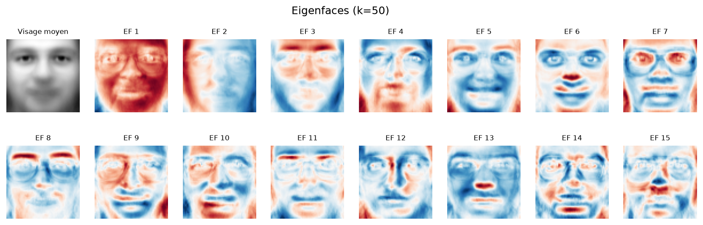
</p>

Les premières eigenfaces encodent surtout l'éclairage (luminosité globale, gradients gauche/droite et haut/bas), les suivantes des traits plus fins (bouche, yeux, lunettes).

### Variance expliquée

<p align="center">
  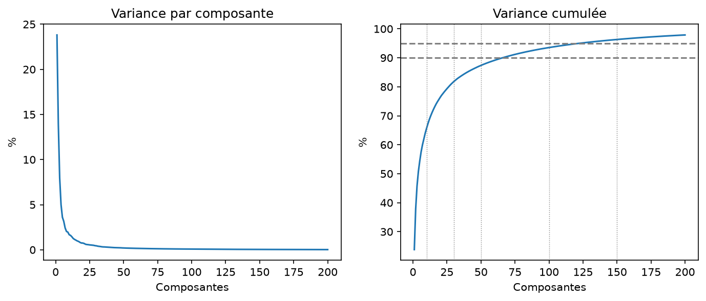
</p>

### Identification : 10 plus proches voisins

Image requête (à gauche) et ses 10 plus proches voisins dans l'espace ACP, pour k = 10, 50 et 150 :

<p align="center">
  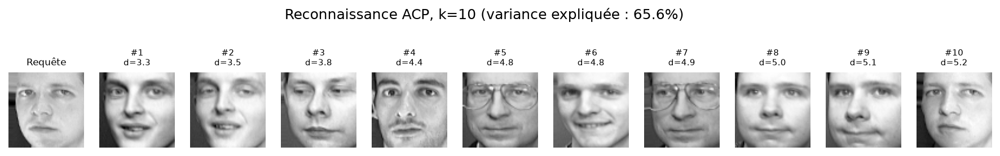<br>
  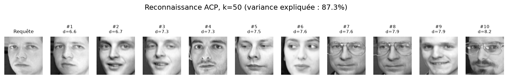<br>
  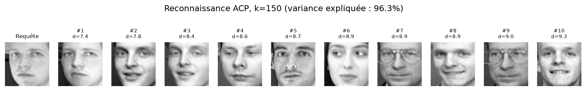
</p>

> Les distances affichées augmentent avec `k` (chaque composante ajoute un terme positif) : elles ne sont comparables qu'à `k` fixe.

### Précision de reconnaissance (leave-one-out, 400 images)

| k | Variance cumulée | Précision 1-NN |
|---:|---:|---:|
| 10 | 65,6 % | 91,0 % |
| 30 | 81,8 % | 95,2 % |
| 50 | 87,4 % | 95,5 % |
| 100 | 93,5 % | 95,2 % |
| 150 | 96,3 % | 95,5 % |

La précision sature dès k ≈ 30–50 : les composantes supplémentaires ajoutent de la variance mais peu d'information discriminante. Un choix raisonnable est **k ≈ 50**.

### Reconstruction

<p align="center">
  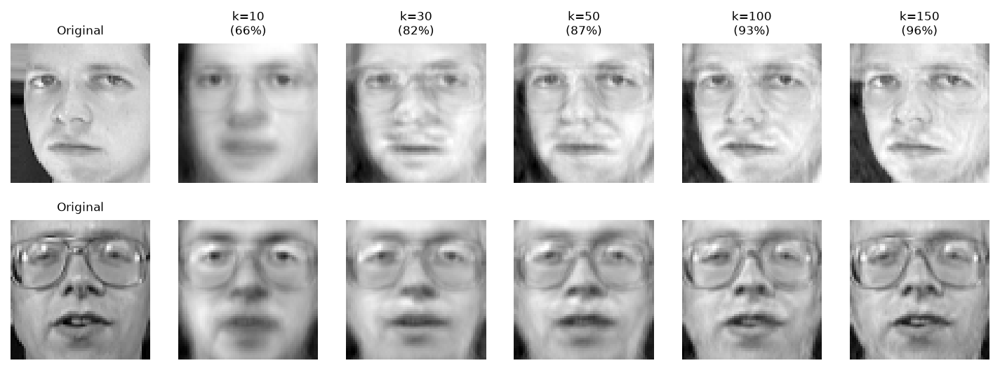
</p>

---

## Partie 2 : Compression SVD

Une image `A` (m×n) est approchée par sa SVD tronquée `A_k = Σᵢ≤ₖ σᵢ uᵢ vᵢᵀ`, optimale au sens de Frobenius (théorème d'Eckart–Young). Trois images de 256×256 sont construites à partir de visages Olivetti : **noir & blanc** (seuil 0,45), **niveaux de gris** et **couleur** (trois sujets sur les canaux R, V, B).

<p align="center">
  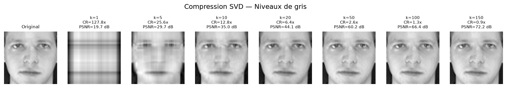<br>
  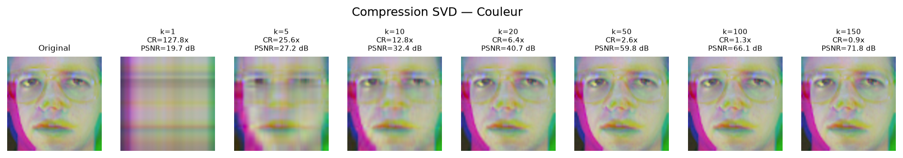<br>
  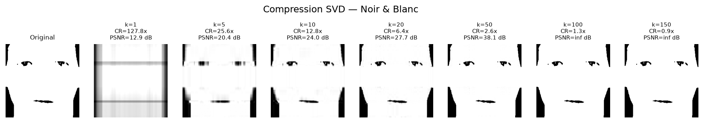
</p>

### Rapport de compression et PSNR

| k | CR | PSNR N&B | PSNR gris | PSNR couleur |
|---:|---:|---:|---:|---:|
| 1 | 127,75:1 | 12,9 dB | 19,7 dB | 19,7 dB |
| 5 | 25,55:1 | 20,4 dB | 29,7 dB | 27,2 dB |
| 10 | 12,78:1 | 24,0 dB | 35,0 dB | 32,4 dB |
| 20 | 6,39:1 | 27,7 dB | 44,1 dB | 40,7 dB |
| 50 | 2,56:1 | 38,1 dB | 60,2 dB | 59,8 dB |
| 100 | 1,28:1 | ∞ | 66,4 dB | 66,1 dB |
| 150 | 0,85:1 | ∞ | 72,2 dB | 71,8 dB |

`CR = m·n / (k·(m+n+1))`. Pour une image 256×256, il n'y a plus aucun gain de stockage au-delà de k = 127 (CR < 1).

<p align="center">
  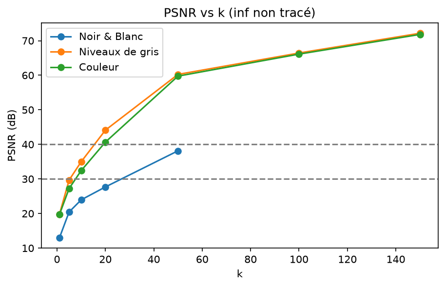
</p>

### Pourquoi l'image binaire est-elle la plus difficile ?

<p align="center">
  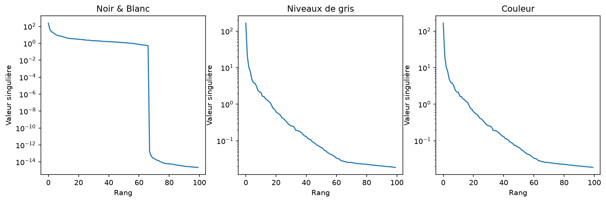
</p>

Les contours abrupts d'une image binaire ne se représentent pas avec peu de termes lisses : son spectre reste quasi plat entre les rangs 15 et 65 environ, puis s'effondre vers zéro (rang numérique ≈ 67, d'où un PSNR infini pour k ≥ 100). Les images en niveaux de gris et en couleur ont au contraire un spectre qui décroît régulièrement, ce qui les rend bien plus compressibles.

---

## Installation et utilisation

**Prérequis :** Python 3 et `pip`.

```bash
# 1. Cloner le dépôt
git clone https://github.com/<votre-pseudo>/olivetti-pca-svd.git
cd olivetti-pca-svd

# 2. (Facultatif) créer un environnement virtuel
python -m venv .venv
source .venv/bin/activate        # Windows : .venv\Scripts\activate

# 3. Installer les dépendances
pip install -r requirements.txt

# 4. Lancer les deux parties
python src/eigenfaces.py         # ACP, eigenfaces, variance, reconnaissance, précision LOO
python src/svd_compression.py    # compression SVD N&B / gris / couleur
```

- Les figures sont écrites dans `results/`.
- La base Olivetti est **téléchargée automatiquement** par scikit-learn au premier lancement (puis mise en cache) : aucune image à fournir.
- La graine de l'ACP est fixée (`random_state=42`) ; de faibles écarts (± 0,1 point de variance) restent possibles entre exécutions à cause du solveur randomisé.

---

## Structure du dépôt

```text
olivetti-pca-svd/
├── README.md
├── requirements.txt
├── .gitignore
├── rapport/
│   └── DOUBABI_ProjetStat.pdf
├── src/
│   ├── common.py              # chargement d'Olivetti, dossier results/
│   ├── eigenfaces.py          # partie 1 : ACP et reconnaissance
│   └── svd_compression.py     # partie 2 : compression SVD
└── results/                   # figures générées (PNG)
```

---

## Méthodes

**ACP / Eigenfaces**
1. Vectorisation des 400 images : `X ∈ ℝ^(400×4096)` ; visage moyen `μ`, matrice centrée `X_c = X − 1μᵀ`.
2. `PCA(n_components=k)` : composantes principales `V_k` (eigenfaces).
3. Projection `z = V_kᵀ (x − μ)`, reconstruction `x̂ = μ + V_k z`.
4. Reconnaissance : distance euclidienne dans l'espace réduit, 10 plus proches voisins ; évaluation par précision 1-NN en *leave-one-out*.

**SVD**
1. `A = U Σ Vᵀ` (`np.linalg.svd`), troncature au rang `k`.
2. Couleur : SVD appliquée indépendamment à chaque canal.
3. Mesures : rapport de compression `CR = m·n / (k(m+n+1))` et `PSNR = 10·log₁₀(1/MSE)` (pixels dans [0, 1]).

**Lien ACP ↔ SVD :** si `X_c = U Σ Vᵀ`, alors `X_cᵀX_c = V Σ² Vᵀ` : les eigenfaces sont les vecteurs singuliers droits de `X_c`.

---

## Limites et pistes d'amélioration

- L'ACP est ajustée sur les 400 images, y compris celle évaluée en *leave-one-out* : séparer apprentissage et test (par exemple 8 images d'apprentissage et 2 de test par sujet) donnerait une estimation plus rigoureuse.
- Les images de 256×256 proviennent d'un sur-échantillonnage de visages 64×64 : le gain de compression réel est surestimé.
- L'image couleur est artificielle (trois visages sur R, V, B) ; le PSNR n'est pas une métrique perceptuelle (ajouter le SSIM).
- Pistes : Fisherfaces, SVM sur les coordonnées ACP, comparaison avec JPEG sur de vraies photographies, SVD randomisée.

---

## Références

1. M. Turk, A. Pentland. *Eigenfaces for recognition*. Journal of Cognitive Neuroscience, 3(1), 1991.
2. F. Samaria, A. Harter. *Parameterisation of a stochastic model for human face identification*. IEEE Workshop on Applications of Computer Vision, 1994.
3. C. Eckart, G. Young. *The approximation of one matrix by another of lower rank*. Psychometrika, 1(3), 1936.
4. G. Golub, C. Van Loan. *Matrix Computations*, 4ᵉ éd., Johns Hopkins University Press, 2013.
5. I. T. Jolliffe. *Principal Component Analysis*, 2ᵉ éd., Springer, 2002.
6. F. Pedregosa et al. *Scikit-learn: Machine Learning in Python*. JMLR, 12, 2011.

---

## Auteur

**DOUBABI Ali** : projet encadré par Ahmed Oirrak, module Traitement d'image / Vision par ordinateur.
